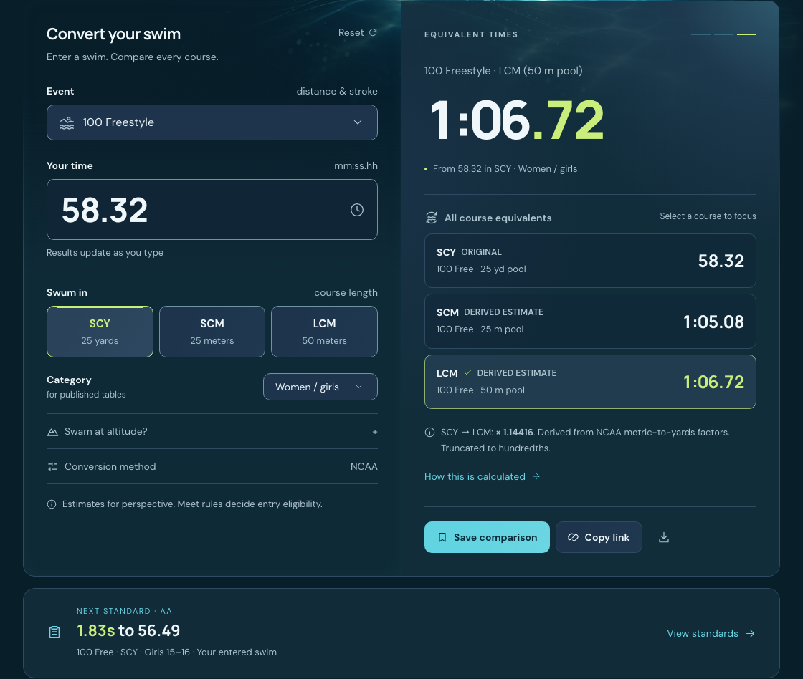
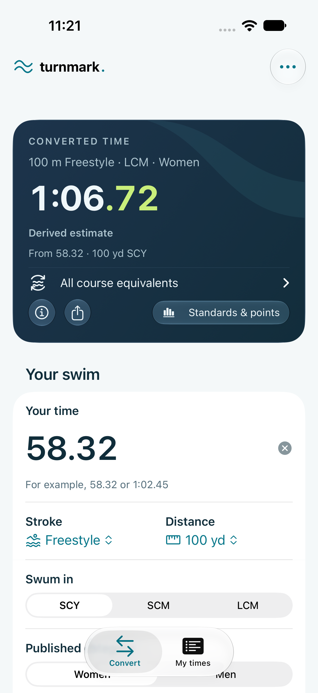
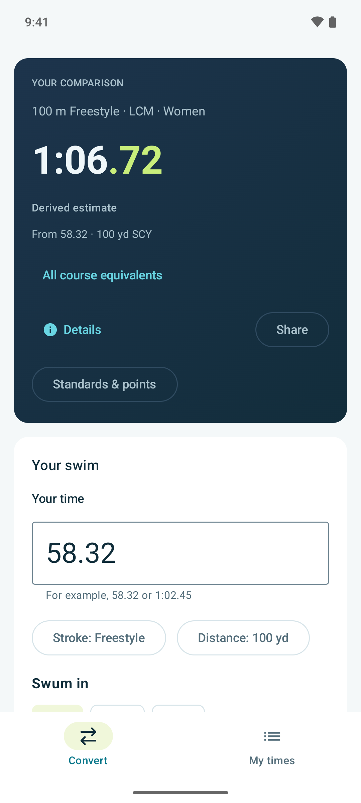
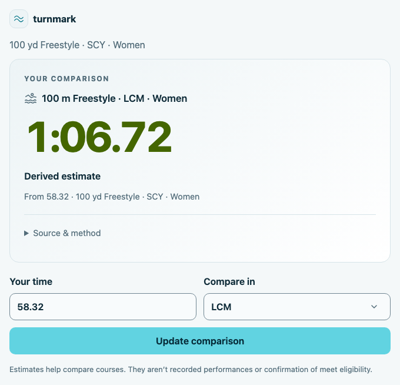

# Turnmark

**Your swim. Any course.**

[Try Turnmark →](https://turnmark.app/)

Swim time conversion, published standards, and World Aquatics points, built around a shared Rust calculation engine. The web app is available today; native iOS and Android apps are in development. Built for swimmers, coaches, and parents who want to understand a swim across pool courses and find a useful next target.

Available in the web app:

- Live SCY / SCM / LCM comparisons with event-specific distance mapping
- Published NCAA metric-to-yards factors, with explicitly labeled derived reverse conversions
- 2,892 published USA Swimming 2024–2028 motivational times, revised October 10, 2025
- Original-course standards ladder with the next level and time gap
- World Aquatics points from 70 published 2026 metric base times
- Automatic, device-local conversion history with stroke filters, restore, remove, and clear
- 904 published 2026 USMS Nationals targets for adults, with explicit SCY/LCM and age-group coverage
- Optional USA Swimming altitude adjustments with feet/meters input and an explicit sea-level comparison
- Shareable URL fragments, CSV export, and an optional local swimboard
- Automatic system light/dark mode with a saved appearance override
- Installable desktop/mobile app with offline calculations and bundled tables
- Pre-rendered introduction and expandable FAQs, canonical/social metadata, and app structured data
- Responsive layouts, keyboard controls, reduced-motion support, and self-hosted fonts

No backend, account, analytics, third-party runtime requests, or uploaded swim data. Conversion history and saved comparisons stay in this browser’s local storage. Sharing a link shares the event, time, category, age group, and elevation contained in its URL fragment.

## In use

The web app is live. The native screens below are development previews, not store releases.

The web converter starts with a blank time. This example shows 58.32 in SCY,
its NCAA course equivalents, and the next published standard for the entered swim.



[Light appearance](docs/screenshots/web-converter-comparison-light.png) ·
[Colorado Timing example](docs/screenshots/web-converter-method-dark.png) ·
[Layout review and mobile flow](docs/CONVERTER_LAYOUT_EXPLORATION.md)

| iOS · Converter                                                                                                                      | Android · Converter                                                                                                                                     |
| ------------------------------------------------------------------------------------------------------------------------------------ | ------------------------------------------------------------------------------------------------------------------------------------------------------- |
|  |  |

[Embed the widget](https://turnmark.app/embed/) · [Connect MCP](https://turnmark.app/mcp/) · [Native review and more screenshots](docs/NATIVE_STANDARDS_REVIEW.md)

## History

Turnmark started long before it had that name. Bri Stanback swam competitively from roughly 1993 to 2005 and built an early swim time converter in the late 1990s, giving swimmers a simple way to compare times across pool courses.

The tool evolved from JavaScript to PHP and eventually came to GitHub as `php-swim-time-conversion`. Along the way, versions of the converter found a home on other swimming websites.

In 2026, Bri returned to the project, modernized it, and gave it the Turnmark name. The familiar converter grew into an offline web app with documented factors, published standards and points, and local swim history. Its calculations now live in one Rust engine, shared through JavaScript, Swift, and Kotlin libraries. That engine now powers the web app, an embeddable calculator, and a public MCP service, with native iOS and Android apps in development. WebMCP is planned. The original idea remains: a useful tool swimmers can trust.

## Develop

Requires Node.js 22.12+ and Rust (pinned by `rust-toolchain.toml`). Install the
pinned WebAssembly binding generator before the first npm install.

```sh
cargo install wasm-bindgen-cli --version 0.2.129 --locked
npm ci
npm run dev
```

The app is served at `http://localhost:5173/`. Production uses Cloudflare Workers Static Assets at `https://turnmark.app/`, rooted at `/`.

```sh
npm run check
npm test
npx playwright install chromium
npm run test:browser
npm run test:sdk:package
npm ci --prefix deployment --ignore-scripts
npm run test:production
npm run build
npm run preview
```

The production app is static files in `dist/`. CI checks types, unit tests, desktop/mobile interactions, accessibility and offline behavior through the local Cloudflare runtime. Trusted `main` builds deploy automatically from an isolated job using a token scoped to the website Worker. PRs have no Cloudflare credentials. See [hosting and deployment](docs/HOSTING.md) for setup and token rotation.

The web app consumes the [Turnmark SDK](packages/sdk/README.md). Its
calculations, clock helpers, and numerical lookups execute in the same Rust core
that generates Swift and Kotlin libraries. Canonical snapshots live in root
`data/`; JavaScript contains API adapters and source metadata. `npm ci` and the
normal development/check/build commands compile the SDK automatically.

The browser loads a bundled WebAssembly asset before hydration; pre-rendering
uses the same engine in Node. Offline caching includes that versioned asset.
See the [shared engine guide](docs/SHARED_ENGINE.md) for packaging, checks and
tradeoffs. The native apps use SwiftUI and Jetpack Compose. A
[compact publisher embed](docs/EMBED.md) is prepared at `/embed/v1/`, with
copyable HTML and a live preview on the [widget setup page](https://turnmark.app/embed/). Remaining platform work is tracked in the
[platform plan](docs/PLATFORM_PLAN.md).
The [MCP adapter](docs/MCP.md) supports offline stdio and stateless Streamable
HTTP at `https://mcp.turnmark.app/mcp`, using the same SDK.
See the [public MCP quick start](https://turnmark.app/mcp/) for connection
settings and [llms.txt](https://turnmark.app/llms.txt) for the agent documentation index.
MCP Apps compatible hosts can show an inline conversion card with editable time
and comparison course; text-only clients retain the same results. The published
local package 0.2.0 includes the same Apps resource. See the
[implementation and host verification notes](docs/MCP_APPS_REVIEW.md).



The [agent interface plan](docs/AGENT_INTERFACES.md) covers future WebMCP work.
The public npm packages [@turnmark/sdk](https://www.npmjs.com/package/@turnmark/sdk)
and [@turnmark/mcp](https://www.npmjs.com/package/@turnmark/mcp) are available at
`0.1.0` and `0.2.0`, respectively.
See [SDK releases](docs/SDK_RELEASES.md) for installation and release status.

The native apps in `apps/ios` and `apps/android` include the shared converter
and Standards & points (B–AAAA, USMS targets and World Aquatics points),
plus offline meet history: record actual swims, correct records, compare personal
bests in My times, and transfer records with a common JSON export/import format. Saved
conversions remain separate from performances. They are development builds,
not yet store releases, and do not yet have all web features. See
[native app setup and scope](docs/NATIVE_APPS.md) for local builds,
simulator/emulator tests, and the public-repository CI boundary.

## Data and calculations

Read [the methodology](docs/METHODOLOGY.md) for sources, rounding behavior, coverage, and limitations, and [the data maintenance guide](docs/DATA.md) for updating the tables. Inputs and original-course benchmarks are separated from course estimates. A converted time is not an official swim or a guarantee of meet-entry eligibility.

Application code is licensed under GPL-3.0-or-later. Published numerical data remains attributed to its respective source organizations. Turnmark is an independent project and is not affiliated with or endorsed by NCAA, USA Swimming, U.S. Masters Swimming, or World Aquatics.

## Community

Bug reports, data corrections, accessibility improvements, and pull requests are welcome.
Read the [contributing guide](CONTRIBUTING.md) for setup, checks, and source-data requirements,
and follow the [code of conduct](CODE_OF_CONDUCT.md). Use the
[issue templates](https://github.com/Stanback/turnmark/issues/new/choose) to report a problem
or suggest an improvement. Report vulnerabilities privately as described in the
[security policy](SECURITY.md). The full application license is in [LICENSE](LICENSE).

## Conversion methods and resources

NCAA remains the default. Choose documented Colorado Timing formulas in the
collapsed Conversion method setting; native apps put it in the overflow menu.
The choice changes course estimates, while standards and points use the original
swim. Shared comparisons retain the selected method. See [methodology](docs/METHODOLOGY.md)
for source editions, supported events and direction-specific formulas.

The footer’s Resources section links to the SwimSwam converter, Swim Standards,
USA Swimming, Swimcloud, USMS and World Aquatics. Turnmark stays focused on
conversion and benchmarks; [the roadmap](docs/PLATFORM_PLAN.md#product-scope-and-anti-goals--october-19-2026)
records the current scope and separate model-research follow-up.

## Install and offline use

Your conversion method, age groups, standards selection, category, swum-in course, elevation, and ft/m choice are remembered in this browser. Restored elevations stay visible in the expanded elevation panel. A shared conversion link overrides remembered swim settings, including altitude. Race time starts blank, and stroke/distance start fresh; conversion history keeps past comparisons. Try an example explicitly loads the sample swim and default settings without adding a history entry. Reset clears the time, restores the app defaults, and updates remembered preferences. Preferences stay on this device and work without an account.

Chrome and Edge can install Turnmark from the address bar/browser menu; the app’s Install button invokes the native prompt when available and otherwise shows instructions. Safari on iPhone/iPad supports Share → Add to Home Screen. Icons include 192px/512px PNGs, a maskable icon, and an Apple touch icon. The manifest and service worker are scoped to `/` on `turnmark.app`.

Once an online visit completes caching, calculations, standards, history, and saved comparisons work without a connection. Source links still need the internet. Browser-managed storage may be cleared or evicted; this is not cloud backup. New static builds are cached separately; a waiting service worker activates after existing app tabs close. The network is preferred for document navigation, so online visits receive the current release. Offline navigation retains the complete active build until a new worker activates, keeping its HTML and asset revisions together.

## Discoverability

The build pre-renders the actual Svelte page and FAQ answers, then hydrates it in the browser. A backend is not needed. Metadata lives in `index.html` and `src/data/site.ts`; `scripts/finish-build.mjs` emits app JSON-LD and `dist/sitemap.xml`. Keep the production URL, Vite base, manifest scope, and service worker base consistent if moving hosts. No search indexing or answer-engine placement is guaranteed, and no Search Console submission is performed automatically.
