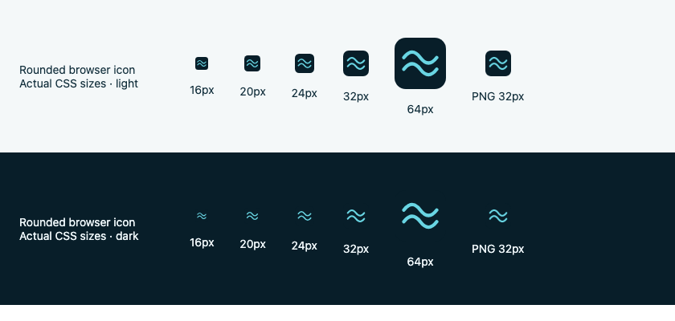

# Turnmark mark

The two-wave geometry in `design/wave.svg` is shared by the website and native
app icons. The shared token source supplies its dark canvas/accent pair: a navy
field and cyan waves. The platforms supply their own icon masks.
`public/icons/app-icon.svg` and `public/favicon.svg` are generated outputs.
The native converter opens straight into its inputs, without a logo, app-name header or promotional title.
Saved and Method retain functional page titles. The [shared design contract](DESIGN_CONTRACT.md)
defines palette ownership and the staged cross-platform adoption.

The website declares the square 192px PNG at the stable
`/icons/favicon-192.png` URL as a favicon, alongside the scalable SVG for browsers.
Keep a raster `rel="icon"` declaration in the homepage HTML: Google's current
Search favicon guidelines list raster formats, including PNG, and recommend
more than 48px. Both the homepage and icon must remain crawlable. Search display
still depends on Google's processing and is not guaranteed.
[Google's favicon guidelines](https://developers.google.com/search/docs/appearance/favicon-in-search).

On Android 12+, the system splash shows the launcher mark against a background
that matches the app's appearance. iOS uses a matching light/dark launch background
and opens directly into the form. Neither platform adds a timed splash or spinner.
See [the design review](NATIVE_DESIGN_REVIEW.md) for the store comparisons and
platform guidance behind this choice.

Browser favicons have rounded backgrounds with transparent corners. The separate
PNG/SVG favicon exports share that shape; native launcher and touch icons retain
full-bleed backgrounds so the operating system owns their masks.

After editing the wave geometry or shared palette, regenerate all brand assets:

```sh
# With npm dependencies and Playwright Chromium installed:
node scripts/generate-brand-assets.mjs
```

The exporter writes the web SVGs, opaque 180/192/512px PNGs, opaque 1024px iOS
app icon, Android adaptive launcher foreground/background, and Android 13+
monochrome icon. It also aligns the PWA manifest's startup colors with the
palette, preserving the manifest's application metadata. Commit the generated resources and `design/brand-manifest.json`.
`node scripts/generate-brand-assets.mjs --check` verifies source/output hashes
without launching a browser; the unit suite runs it. Ordinary native builds do
not need Node or a browser to produce their icons.

The iOS icon is a flat asset-catalog icon for now. Layered Icon Composer artwork
and its light/dark/clear/tinted previews remain part of store-artwork refinement.
No lighting, rounded mask, or simulated glass is baked into the app icon.

Browser favicons use an optical variant of the canonical wave: a 1.32× centered
scale and a slightly heavier stroke. This fills about 71% of the rounded square
width and keeps both crests distinct at 16–32px. Launcher and in-app wave geometry
remain unchanged; regenerate the derived browser SVG/PNG with the brand script.


