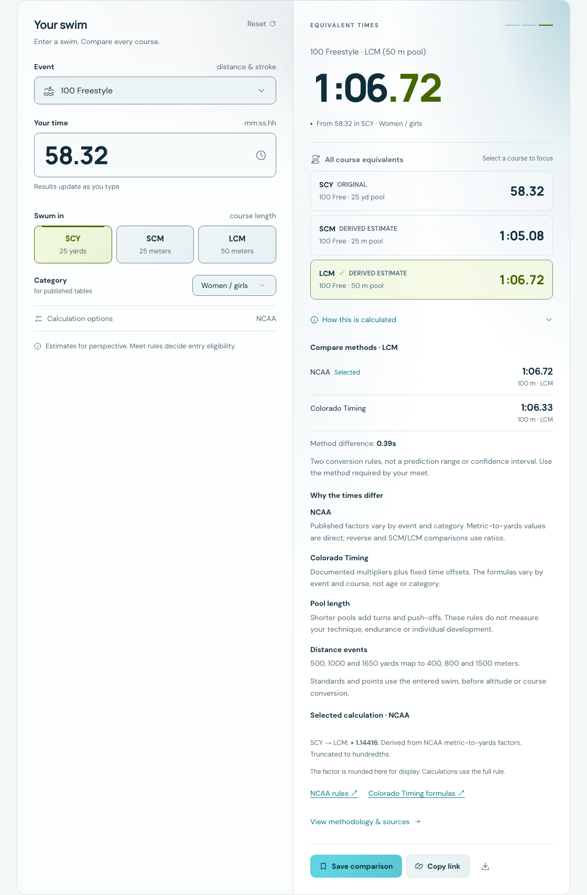
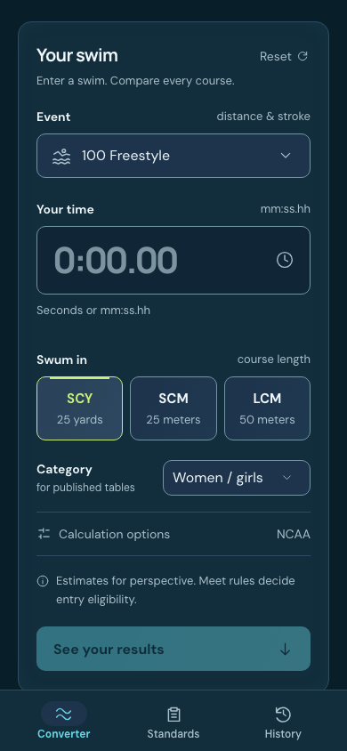
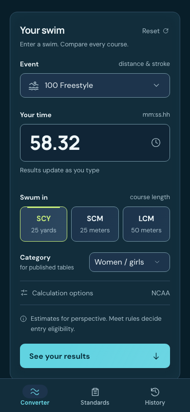
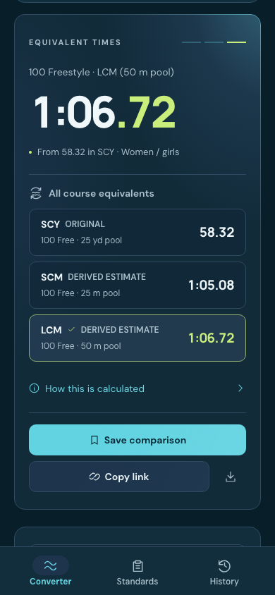

# Converter layout exploration

The initial web flow shipped in PR26. The October 19 follow-up removes the
redundant target banner, gives Standards / Points its own row, and places recent
and saved comparisons below it. Recent conversions, Sources & methodology and
Swimming resources use disclosures; About remains visible. Native adoption is a
paired follow-up documented in [Native visual review](NATIVE_VISUAL_REVIEW.md).
Conversion-model research remains separate.

## Direction

Position this as [an offline swim companion](PRODUCT_POSITIONING.md): compare
courses, understand published benchmarks and keep a small private scratchpad.
Native development builds can log actual practice/meet swims; web saves
comparisons. Keep those capabilities and record types distinct in product copy.

Bring the editable swim and its three course equivalents into one visual group.
Make the original time, destination event/course and derived estimate easy to
scan. Put the standards/points view directly after the converter; its existing
next-target assessment is the single source of that information. Keep the navy,
cyan and lime identity and generated semantic tokens.

Keep water artwork behind the content, restrained border highlights and subtle
button hover feedback. Preserve readable surfaces, focus visibility, reduced
motion and light/dark appearances. Decorative branching light trails, miniature
swimmers and invented probability/confidence graphics are outside this study.

NCAA stays the default. The alternative conversion method stays a quiet setting;
its selected source and original-swim benchmark distinction remain accessible.
Native controls remain platform-owned. The paired native follow-up adapts this
hierarchy rather than sharing web layout code.

## Implemented web flow

The implemented flow makes the starting point clearer: **enter a swim →
compare course equivalents → explore targets or methods**. On a narrow screen,
editable inputs come before the result. Preserve the desktop side-by-side
comparison; do not shrink that entire composition into a phone.

Arrival and Reset use a blank time and a recognizable placeholder. Direct
entry is the only starting action; an example button is unnecessary. Remembered swimmer preferences retain their existing contract;
race time starts fresh. Shared URLs and restored saved/recent comparisons still
open their explicit swim. Empty input is a neutral state; malformed nonempty
input shows validation, with no stale result or enabled save/share action.

Keep result updates stable while typing: no automatic scrolling, disappearing
keyboard, reordered controls or layout jump to a result. Below the inputs, show
all three course equivalents clearly, with the original identified. Follow with
the full Standards / Points section and quieter local comparisons. Methods,
altitude and other optional details remain quiet. Do not add an experimental
probability display until the separate research work earns one.

The paired native follow-up adopts input-first phone arrival and all-course
rows while preserving native navigation, active entry, Dynamic Type and platform
controls. Larger workspaces retain independent input/result panes. Check its
actual-build review separately; a web layout cannot establish native parity.

Polish supports this hierarchy: readable labels, consistent tokens, restrained
border illumination, generous touch targets and quieter secondary actions.
Keep water decorative. Save comparison and Log swim have different meanings:
logging an actual race must remain an explicit action, never an automatic side
effect of exploring estimates.

Potential additional benchmarks are reviewed in
[the maintenance shortlist](BENCHMARK_EXPANSION.md); adding their data or a new
scoring system is not part of this layout PR.

## README screenshots are part of this PR

The README images come from running builds after the layout settled. Supplied
concept art is not used as evidence of implemented behavior. The review follows
these capture conventions:

- Lead with the main converter: a readable original swim, editable time/event
  and SCY/SCM/LCM results. Avoid a hero-heavy crop that cuts off the converter.
- Keep the paired iOS and Android previews on their normal Convert/home view,
  using the same sample swim. Show enough input and converted result context;
  standards and points sheets belong in the detailed review.
- Make the NCAA/Colorado capability discoverable where shown, with a compact
  supplementary actual-build capture if opening settings would obscure the
  main comparison. Keep the lead screenshot representative of the NCAA default.
- Review existing widget/MCP images where this PR touches their presentation.
  Distinguish published npm behavior from newer source-only UI.
- Use sample data only. Check both appearances and narrow/large-text layouts in
  the detailed review; keep the README's gallery small, legible and current.
- Update image paths, alt text and captions together. Record source revision,
  method, sample event/time, viewport/device and capture procedure in the review.

The README leads with an actual converter-region capture containing the inputs
and three equivalents. Colorado is linked separately. Native home images are
maintained by the paired native follow-up; its own review records native build
and test evidence. Widget and MCP captures are maintained in their reviews.

## Actual-build review — October 19, 2026

| Desktop, NCAA default                                                                        | Same input, light appearance                                                |
| -------------------------------------------------------------------------------------------- | --------------------------------------------------------------------------- |
|  |  |

| Phone arrival                                                                                                                    | Entered sample inputs                                                                                                | Comparison below the inputs                                                                                                              |
| -------------------------------------------------------------------------------------------------------------------------------- | -------------------------------------------------------------------------------------------------------------------- | ---------------------------------------------------------------------------------------------------------------------------------------- |
|  |  |  |

[Colorado method and unchanged entered swim](screenshots/web-converter-method-dark.png) ·
[320px long-time and enlarged-root-text content review](screenshots/web-converter-large-text.png)

[Full desktop composition with the water artwork](screenshots/web-converter-desktop-layout-dark.png) ·
[Phone calculation disclosure and actions](screenshots/web-converter-method-mobile.png)

The polish pass keeps the multiplier/source explanation in a native HTML
disclosure, closed initially, with a route to the full methodology inside it.
Original/published/derived labels stay visible on the course rows. The disclosure
supports keyboard activation and continues to follow the selected course.
Selected row hover retains its selection fill and adds a restrained border
highlight; the surrounding numerical panel remains static.

Phone rows and vertical gaps are tighter. Save comparison takes a full row,
followed by Copy link and the download action. At the reviewed 390×844 viewport,
the default three-course comparison and all actions fit above bottom navigation
after See your results. Shorter screens, expanded details and larger text scroll
normally; this is not a fixed-height panel or a requirement to shrink text.

The desktop capture uses Chromium at 1120×1450, device scale 1, reduced motion,
and a crop of `#converter`. It excludes the hero deliberately so controls and
results remain legible in the README. Light/dark use the same 100 freestyle,
women/girls, age 15–16, SCY, 58.32 sample and NCAA default. The method supplement
opens Calculation options and the calculation disclosure, then selects documented Colorado Timing, yielding
1:06.33 LCM; the AA gap remains 1.83s because it uses the original SCY swim.

Mobile captures use 390×844 and ordinary viewport screenshots, with the input or
results panel scrolled to the top. They retain the actual fixed navigation bar.
The 320×900 content check uses 59:59.99 and a 150% root-font preference; this is
a narrow reflow check, not proof of complete browser zoom or screen-reader
coverage. Its long content crop omits fixed navigation to avoid an artificial
navigation overlay midway through the exported image. Category controls stack at the smallest width, and age controls can
shrink to their container instead of overflowing. Capture source hashes are in
the [local review manifest](screenshots/converter-review.json).

The shared semantic tokens, static water artwork, original/derived labels,
quiet method/altitude settings and explicit result navigation remain intact.
Standards / Points now occupies its own full-width row. Recent conversions is
collapsed initially with its count; History navigation opens it. Saved comparisons
follow as a separate section. About stays expanded, while Sources & methodology
and Swimming resources open on demand. Explicit methodology links open their
section before scrolling to it.

## Completion checks

This pass passes Svelte/TypeScript checks, 138 unit tests, 43 browser cases
(one desktop-inapplicable case skipped), and 20 production/offline cases.
Light/dark screenshots, 320px controls, enlarged root text, invalid/unavailable
results, method sharing/persistence, keyboard focus/disclosure and phone action
visibility were reviewed. The owner approved the web direction on October 19, 2026. Final hosted branch
checks remain the merge gate. The method-comparison follow-up also updates the
widget and MCP; native alignment is reviewed separately.

- Confirm which layout to keep through actual desktop/mobile browser previews.
- Keep calculations, unsupported/invalid states, offline behavior, shared links,
  keyboard access and original-swim standards/points semantics intact.
- Run web type/unit/browser/production checks for implemented layout changes.
  Exercise widget/MCP or native consumers only if this study changes them.
- Inspect the replacement README images at their rendered GitHub size and verify
  their relative links. Do not mark this draft ready with stale screenshots.

The altitude follow-up groups elevation/unit and policy fields with consistent
label spacing. It keeps the selected adjustment compact in the input panel and
places the complete USA Swimming / NCAA comparison once in calculation details.
About has breathing room after history; Sources and Swimming resources share a
compact disclosure treatment with one divider.

[Web altitude settings](screenshots/web-altitude-settings.png) ·
[Widget altitude settings](screenshots/widget-altitude-settings-dark.png)
