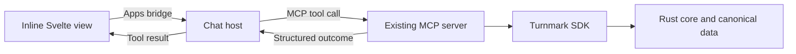

# MCP Apps research and implementation plan

Research date: October 18, 2026. Status: research and a transport compatibility
probe completed; Turnmark's interactive MCP UI is **not implemented or deployed**.
The existing six calculation tools and npm `0.1.0` releases remain the baseline.

## Recommendation

Build an inline conversion result card using the official MCP Apps extension
and `@modelcontextprotocol/ext-apps`. Keep the existing tools useful to text
clients. Use Svelte for this small view, with the calculation result supplied by
the MCP server's existing Rust-backed SDK. Reuse presentation where useful with
the publisher widget; give each surface its own host adapter.

The initial interaction should answer a concrete question: “What is my swim in
another course, and what changes when I edit the time or destination?” Show the
answer, entered swim, destination event, estimate kind and source together.
Standards and points can receive their own focused views after this works well.
Personal history, coach management and WebMCP remain separate work.

## Which UI protocol

MCP Apps is the official optional UI extension. A tool links a `ui://` resource
using `_meta.ui.resourceUri`; the resource contains HTML with MIME type
`text/html;profile=mcp-app`. The host renders it in an isolated frame and proxies
messages between the view and server. Text content remains meaningful even when
UI is available. Target the stable January 26 specification, checking SDK
behavior against it rather than copying unreleased draft additions.
[Stable specification](https://github.com/modelcontextprotocol/ext-apps/blob/main/specification/2026-01-26/apps.mdx).

The MCP-UI project now implements MCP Apps too. Its client SDK is useful when
building a chat host. Turnmark supplies tools and a view, so the official Apps
SDK is sufficient; the older MCP-UI resource/action format adds no needed
compatibility target for our first version.
[MCP-UI's current direction](https://mcpui.dev/).

ChatGPT's current documentation explicitly recommends the standard bridge,
adding `window.openai` only for capabilities without a standard equivalent.
Build around `App`, not a ChatGPT-only global.
[OpenAI quick start](https://developers.openai.com/plugins/build/app-quickstart).

WebMCP exposes website functionality to browser agents. It is independent of
rendering a tool's UI inside a conversation; implementing this view does not
ship the planned WebMCP adapter.

## Host support and acceptance targets

Documentation establishes potential support, not that Turnmark has passed in a
particular account or application version. Record host version, transport and
observed behavior during implementation.

| Host              | Documented behavior                                                                                                                                              | Turnmark acceptance target                                                                                                                                                                                                             |
| ----------------- | ---------------------------------------------------------------------------------------------------------------------------------------------------------------- | -------------------------------------------------------------------------------------------------------------------------------------------------------------------------------------------------------------------------------------- |
| VS Code           | MCP Apps, with inline display only; messages fill the composer rather than auto-send, and model-context updates appear as attachments.                           | First desktop target. Verify the real card, tool edits, keyboard operation and theme changes. [VS Code guide](https://code.visualstudio.com/api/extension-guides/ai/mcp#_mcp-apps).                                                    |
| ChatGPT           | Implements the MCP Apps standard; custom server connections are subject to account/workspace policy.                                                             | Test the public HTTPS endpoint and standard bridge. Verify tool selection, follow-ups and the model-readable answer separately from rendering. [Connection and testing](https://developers.openai.com/plugins/deploy/connect-chatgpt). |
| Claude            | Interactive connectors are documented across web, desktop, Cowork and iOS/Android. Directory acceptance and custom connector availability are separate concerns. | Test a custom connection on desktop/web first, then mobile; do not infer all surfaces work from a desktop screenshot. [Claude guide](https://support.claude.com/en/articles/13454812-use-interactive-connectors-in-claude).            |
| Other MCP clients | UI extension support varies.                                                                                                                                     | Preserve all six tools and their existing results; classify as text-only until actual rendering is verified.                                                                                                                           |

Start with inline mode across hosts. Fullscreen, picture-in-picture, clipboard,
downloads and automatic chat messages are unnecessary for a conversion card.

## The stateless transport finding

The deployed service creates a fresh protocol server per request using
`agents/mcp/server`. Cloudflare documents the factory lifecycle and its modern
and legacy lanes. Retain that architecture; UI does not itself require a
Durable Object, persistent session, subscriptions or a database.
[Cloudflare handler API](https://developers.cloudflare.com/agents/model-context-protocol/apis/handler-api/).

The endpoint is Streamable HTTP at `/mcp`, with JSON responses on the modern
path. Compatibility for older protocol clients uses that same endpoint. There
is no legacy `/sse` endpoint or separate SSE/message connection. SSE framing
within a Streamable HTTP response is distinct from the deprecated HTTP+SSE
transport; the Apps host/frame bridge does not require that old transport.
[Cloudflare transport guide](https://developers.cloudflare.com/agents/model-context-protocol/protocol/transport/).

A local, isolated probe used the actual published dependencies:

| Dependency                                | Version tested |
| ----------------------------------------- | -------------- |
| `@modelcontextprotocol/ext-apps`          | `2.0.3`        |
| `@modelcontextprotocol/client` / `server` | `2.3.1`        |
| `agents`                                  | `0.28.1`       |
| `zod`                                     | `4.6.7`        |

It registered a UI-linked probe tool and a static HTML resource, then connected
the official HTTP client directly to the Agents handler's `fetch`. Four cases
passed tool discovery, a text result, resource reads, the Apps MIME type and
empty network CSP declarations. This tests protocol integration; it does not
test a browser sandbox or a real chat host.

The [probe source](research/mcp-apps-probe.mjs) is a research artifact, outside
the product build. To repeat it from the repository root without adding
dependencies to the workspace:

```sh
research_dir="$(mktemp -d)"
cp docs/research/mcp-apps-probe.mjs "$research_dir/probe.mjs"
npm install --prefix "$research_dir" --ignore-scripts --no-audit --no-fund \
  @modelcontextprotocol/ext-apps@2.0.3 @modelcontextprotocol/client@2.3.1 \
  @modelcontextprotocol/server@2.3.1 agents@0.28.1 zod@4.6.7
node "$research_dir/probe.mjs"
```

The probe sends no network requests after dependencies are installed and needs
no credentials. It passes a local request directly into the handler, including
the Host header a real HTTP transport would provide.

| Protocol     | Client advertises Apps | Capability visible during construction | Visible inside tool callback |
| ------------ | ---------------------- | -------------------------------------- | ---------------------------- |
| Legacy       | No                     | No                                     | No                           |
| Legacy       | Yes                    | No                                     | No                           |
| `2026-07-28` | No                     | No                                     | No                           |
| `2026-07-28` | Yes                    | No                                     | Yes                          |

The probe calls `getUiCapability(server.server.getClientCapabilities())` at
both points. Construction happens before the request's identity is installed;
legacy HTTP requests also do not retain a previous initialization's state.
Blindly copying a construction-time capability gate would therefore hide the
UI from capable clients.

Proposed integration: register the same six tools and a static UI resource on
every fresh server, adding UI metadata to `convert_swim`. Let a capable host
choose whether to render it. Preserve text and structured outcomes in every
case. This follows the static registration pattern in the official quick start;
verify it in actual hosts before release. Never use a global cached capability
or user-agent sniffing. Capability declarations are not authorization.
[Official registration example](https://apps.extensions.modelcontextprotocol.io/api/documents/quickstart.html).

## View and calculation ownership



Keep `convert_swim`'s input and output schemas. Its tool arguments supply the
entered swim/table/destination; its structured outcome supplies the answer and
provenance. The view needs no Wasm runtime, numerical dataset or extra
calculation API. Editing the destination or entered time issues an explicit
`app.callServerTool` request through the host. Local stdio remains offline;
using the remote Worker requires a connection for new calculations.

Use the existing `apps/embed/Widget.svelte` as a visual reference. It currently
owns interactive inputs and invokes the SDK directly. Share small result/context
components only where that reduces real duplication. An MCP card should not
load `/embed/v1/` in a nested iframe: that would introduce another frame,
network/assets policy and a second independent state owner.

Keep numerical/semantic validation in Rust. View checks are for protocol shape
and safe rendering. Do not treat `structuredContent` as private: ChatGPT exposes
it to both the model and component. Preserve the existing public outcome shape;
never add credentials or personal history to results or template metadata.
[OpenAI result field reference](https://developers.openai.com/plugins/reference#tool-results).

## Product behavior

The first card should contain:

- A prominent converted time and the **returned** event distance/course. For
  example, a 500-yard event may map to 400 meters; do not reuse the input label.
- The entered time and original event, published category, and a visible
  entered/published-factor/derived-estimate label.
- A compact time input, destination selector and explicit **Recalculate**
  action. Keep the other original arguments visible; broader editing can follow.
- Source/method edition and an accessible source link. An optional **Open
  Turnmark** link uses the existing share contract and requires a user click.

No decorative app banner, repeated chat composer or navigation shell. An inline
card should remain focused and avoid deep navigation or nested scrolling;
OpenAI's UI guidance also recommends at most two primary actions.
[Inline card guidance](https://developers.openai.com/plugins/concepts/ui-guidelines#inline-card).

Preserve the last confirmed result while an edit is pending, clearly marking
that it belongs to the previous inputs. Disable duplicate submissions and
ignore late responses after a newer edit/cancellation. Distinguish loading,
transport failure, protocol error, semantic `invalid` and published-data
`unavailable`. Missing targets never become zero or a successful-looking result.
Do not silently substitute an event, category, edition or time.

Use the host's theme and style variables, with readable system-font fallbacks;
respond to live changes, narrow widths, larger text and reduced motion. The
official style helpers apply host variables and theme to the document.
[Host variables](https://apps.extensions.modelcontextprotocol.io/api/functions/app.applyHostStyleVariables.html),
[document theme](https://apps.extensions.modelcontextprotocol.io/api/functions/app.applyDocumentTheme.html).

Register input/result/cancellation/context handlers before connecting the `App`.
Use complete tool input to establish editable state; partial streamed input is
not a calculation request. Handle teardown and connection failure explicitly.
Use the SDK transport instead of hand-written `postMessage` routing.
[App lifecycle API](https://apps.extensions.modelcontextprotocol.io/api/classes/app.App.html).

If a UI edit changes the answer, use `updateModelContext` after a completed
recalculation to provide the exact current inputs and result, where supported.
Do not auto-send a conversational message or assume the assistant saw every
local edit. Check that follow-up questions use the updated swim in each host.
[Context update patterns](https://apps.extensions.modelcontextprotocol.io/api/documents/patterns.html).

## Security, hosting and cost

Bundle HTML, JavaScript and CSS into one resource at build time. Serve the same
bytes from Node and the Worker. Use an immutable, content-versioned URI such as
`ui://turnmark/conversion/<content-hash>.html`; do not reuse a URI for changed
content. Host caching makes URI versioning part of the release contract.
[Resource and caching guidance](https://developers.openai.com/plugins/build/chatgpt-ui#embed-the-component-in-the-server-response).

Declare no external connections, resource origins or nested frames for the
first view. Put CSP declarations on returned resource contents, where hosts
read them. Bundle styles and system fonts; tool calls cross the host bridge,
not direct browser `fetch` to our Worker. This avoids needing a stable iframe
origin or broadening production CORS. A custom host that connects directly from
a browser needs its own trusted proxy or narrowly scoped development policy.
[MCP Apps CSP/CORS guidance](https://github.com/modelcontextprotocol/ext-apps/blob/82221c0c8ce7661efa6771c9d461511b1650495f/docs/csp-cors.md).

Render supplied text as text; never inject input/result strings into HTML.
Allow source/open-app links only through validated HTTPS URLs and the host's
link API. Request no device permissions or storage. Host isolation does not
replace input validation, and untrusted result data can still contain hostile
strings. Maintain the existing server-side request limits and sanitized logs.
[OpenAI security guidance](https://developers.openai.com/plugins/guides/security-privacy).

Keep the existing Free Worker, scopes and isolated deployment credentials.
Resource reads count toward the same rate limits as tools; an explicit submit
avoids a network call per keystroke. No polling or background refresh. Handle
429 without automatic retry loops and retain current inputs when unavailable.
Measure bundled response size, CPU and request counts with the actual Worker
before release. Avoid a second Worker or paid service for this feature.

ChatGPT directory submission additionally requires a dedicated UI domain in
resource metadata. That is a host-specific publication requirement, separate
from adding a standard view to our server; determine its exact configuration
when testing submission. Do not invent a universal sandbox domain shared by
all hosts.
[OpenAI component metadata](https://developers.openai.com/plugins/reference#component-resource-_meta-fields).

## Build, packaging and CI

Use a small private `apps/mcp-ui/` view entry and a deterministic build that
embeds its HTML into the MCP package's distribution. The Worker must import
bundled bytes, not read the filesystem or fetch the website at runtime. The npm
tarball must contain everything required to read the resource offline, alongside
the appropriate source/license material. Keep the SDK independent of Apps UI.

The official package offers a framework-independent `App` class and Svelte
examples. npm reports `ext-apps@2.0.3` with MCP 2.x peers; the isolated probe
confirmed compatibility with our pinned 2.3.1 packages. React peers are optional.
Pin the implementation dependency and lockfile; no web framework migration is
needed. The 2.x dependency change does not change the Apps iframe wire protocol.
[SDK migration guide](https://apps.extensions.modelcontextprotocol.io/api/documents/migrate-to-v2.html),
[Svelte example](https://github.com/modelcontextprotocol/ext-apps/tree/82221c0c8ce7661efa6771c9d461511b1650495f/examples/basic-server-svelte).

When introducing the path/build script, update CI selection and its tests in
the same change. MCP view changes must run UI browser tests and MCP packaging /
Worker checks; shared presentation changes must also exercise the web/embed
consumer. Native builds are only needed if shared engine/native inputs change,
or the existing fail-safe rules select all for workflow/selection changes.
Do not add a UI path that falls through to “all platforms” on every later edit.

A compatible MCP feature release can leave `@turnmark/sdk@0.1.0` unchanged.
Choose and document the MCP adapter version separately; package version,
protocol server version and immutable UI URI must describe the actual release.
Already-published `0.1.0` archives cannot be replaced. Verify fresh registry
installation after the new MCP package is published.

## Implementation order and release evidence

1. Add the self-contained view/resource, metadata on `convert_swim`, build
   packaging and affected-check mappings. Preserve every existing schema and
   conformance outcome. Begin with a read-only result before adding edits.
2. Add time/destination edits, pending/error/cancellation behavior, source links,
   host styling, resizing and model-context updates. No new domain tools.
3. Extend protocol tests across stdio and local workerd, both supported protocol
   modes, clients with and without the UI capability, resource discovery/reads,
   MIME/CSP, versioned URI and unknown-resource rejection. Retain all existing
   exact SDK comparisons and malformed-input checks.
4. Test the actual packed npm artifact outside the workspace with fetch disabled;
   verify the resource is present and no relative files/CDNs are required.
5. Exercise the official reference host's bridge and sandbox, then real VS Code,
   Claude and ChatGPT. The reference host is a development aid, not a hosted
   product dependency. Protocol Inspector output alone does not prove rendering.
   [Official testing guide](https://apps.extensions.modelcontextprotocol.io/api/documents/testing-mcp-apps.html).
6. Capture light/dark/narrow screenshots; check keyboard/focus, accessible result
   announcements, large text, no overflow, hostile strings, unavailable results,
   denied host methods, delayed responses, cancellation and reconnection. Test
   live theme changes and two cards without state leaking between them.
7. Record real-host versions and evaluation prompts/results. Verify follow-up
   context after a UI edit, text fallback without Apps support, and 429 recovery.
   Keep hosts/surfaces not exercised clearly marked unverified.
8. Review and merge passing checks, deploy through the existing protected main
   workflow, smoke-test public resource/tool calls, update setup/llms docs, then
   publish and verify the versioned MCP package. Directory submission is a
   separate rollout after these checks.

Research does not establish real-host rendering, mobile compatibility, final
bundle size/CPU, or directory approval. Those are implementation release gates,
to be recorded before claiming support.
