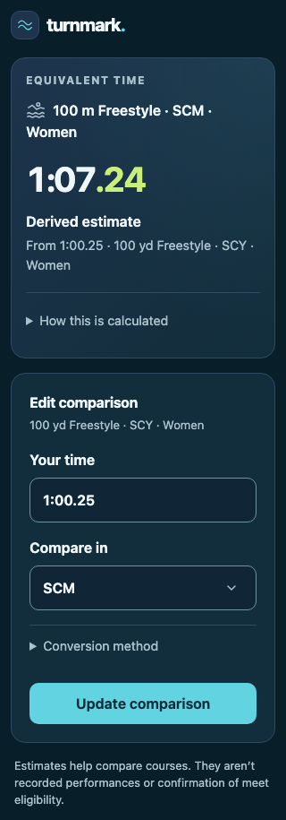

# MCP Apps implementation review

Implemented October 18, 2026 using the official MCP Apps extension and pinned
`@modelcontextprotocol/ext-apps@2.0.3`. This is an inline conversion card, not a
replacement transport or the older MCP-UI action/resource convention.
The [research](MCP_APPS.md) records the protocol/host decisions and primary sources.

## User experience

The card displays the destination event/course/category and returned time, its
original performance, published/derived kind, and source edition. Time, target
course and the collapsed conversion method are editable; an explicit Update comparison calls `convert_swim` through
the host. Original event/course/category stay fixed to the request. No factors,
numerical tables or Wasm execute in the view. A 500 yd→400 m conversion uses the
returned event. Other tools retain text/structured results.

| Light, 680 px                                                                                                                     | Dark, 320 px                                                                                       |
| --------------------------------------------------------------------------------------------------------------------------------- | -------------------------------------------------------------------------------------------------- |
|  |  |

The October 19 follow-up uses the same signature navy numerical surface as the
native apps in both host appearances, with a white clock and lime hundredths.
The generated `.tm-result-surface` scope supplies the shared dark roles; no
independent component palette is added. Original context sits beside editable
controls instead of being repeated above the result. Calculation details hold
the NCAA/Colorado comparison and distinguish method differences from predictive
uncertainty. The form follows the host light/dark appearance.

[Expanded comparison and calculation detail](screenshots/mcp-methods-light.png).

The shared generated colors and canonical wave give it Turnmark's identity.
All palette roles come from `design/turnmark.tokens.json` through the generated
CSS bundled into the resource. Keep future UI states on that contract; the host
can change layout, typography and accessibility behavior without introducing an
independent color palette. The deeper navy controls match web/widget/native.
Controls use the host/browser's native behavior and system typography. Host
appearance changes apply live; automatic sizing reports content height. At 200%
text, the clock fits one line and surrounding copy wraps normally:

## Boundaries

- Six existing read-only tools stay intact. `convert_swim` adds comparison fields
  while preserving its primary outcome; the other output schemas are unchanged.
  Only `convert_swim`
  advertises `_meta.ui.resourceUri`; the one static resource is registered
  independently of initialization capabilities for stateless HTTP compatibility.
- Current source URI `ui://turnmark/conversion/0.3.0-r2.html`, MIME
  `text/html;profile=mcp-app`. Change the resource version for later view releases.
  The revised resource has a new URI to avoid reusing the previous view's cache
  key. The alternative-method release is not yet published to npm; published `0.2.0` keeps
  its original `ui://turnmark/conversion/0.2.0.html` resource.
  Both list/read carry CSP with empty connect/resource/frame domain lists.
- The card wordmark uses the shared accent token for its period in both themes.
- One self-contained HTML asset, including the official bridge SDK: approximately
  664 KB raw, under an enforced 750,000-byte build budget. No CDN,
  font request, direct fetch, local storage, history access or nested iframe.
  Installed third-party license notices are derived from the bundle graph and
  included in both the HTML resource and npm archive.
- Worker dry run: approximately 2,283 KiB total / 468 KiB gzip. This fits the
  [Workers Free compressed-script allowance](https://developers.cloudflare.com/workers/platform/limits/).
  Local workerd startup profiling measured a 42.2 ms window / 22.5 ms active
  sample time; that is module startup, not an edge request CPU measurement.
  Existing body limits, approximate per-IP/aggregate rate limits, Free plan,
  Origin policy and protected deployment credentials remain unchanged.
- Updates are explicit, single-flight, abortable and time-bounded. Generation
  checks discard late responses. Failed requests preserve the committed result.
  Model context updates follow a successful edit; denied context updates explain
  how to continue. No automatic new conversation message or retry loop.
- Text uses DOM textContent, source links go through host approval, and the test
  host forwards only the intended conversion tool. The real host owns capability,
  tool approval, sandbox and link policies; this card cannot grant itself access.

## Verification evidence

`npm run test:mcp` builds and types the card, then runs:

- Packed stdio and local workerd Streamable HTTP, in both supported protocol
  modes, with and without Apps capabilities: eight combinations. Each checks
  53 SDK-equal primary outcomes plus both method outcomes, eight malformed requests, all tools, cancellation,
  resource discovery/read/unknown URI, MIME, immutable URI, CSP and text fallback.
- Packed stdio runs outside the workspace with network disabled. Once SDK 0.2.0 is published, a second fresh installation against that exact
  registry version also runs both protocol modes, result fixtures and resource
  reads with runtime fetch disabled. Development explicitly reports an unpublished
  dependency; release mode fails until the registry check can run. The prior
  0.2.0 release was verified with registry SDK 0.1.0.
- Actual local Worker bindings enforce request/body/Origin/rate/aggregate limits.
- Official AppBridge in Chromium with both a real stdio MCP server and a local
  Workers Streamable HTTP server, an opaque-origin
  `allow-scripts` sandbox and strict CSP: rendering, resize, keyboard update,
  theme changes, 320 px width, 200% text, explicit cancellation/late response,
  denied tool/context/link calls, malformed/invalid/unavailable outcomes, hostile strings,
  mapped destination event and independent card instances. Axe reports no
  violations or untested-frame finding. No external requests or page errors.
- Svelte/TypeScript checks, web unit tests, 19 production-runtime tests and
  affected-check selection tests pass. UI/build/harness edits select MCP/core;
  shared tokens also select web; ordinary card edits do not rebuild native apps.

## Acceptance and release status

The browser screenshots are from the official bridge test host, **not** ChatGPT,
Claude or VS Code. Specific desktop/mobile host versions still need a real-host
visual/approval/context acceptance pass. Protocol compatibility does not establish rendering in
every host or directory approval. Local profiling does not establish edge CPU
usage; verify production responses after deployment and monitor actual Free
limits without enabling a paid plan.

The published npm package remains MCP **0.2.0**; the current source/server/UI
prepares the **unreleased 0.3.0** method-selector release with SDK **0.2.0**. Protected main CI can update
the hosted Worker independently of npm publication. The 0.2.0 release used
the main-only manual workflow and npm trusted publishing, with the tested
archive's checksum verified before publication. SDK **0.1.0** remains published; SDK **0.2.0** must publish before this adapter. A fresh external registry consumer verified
the same resource and offline tools in both protocol modes, with and without
Apps capability. See [SDK releases](SDK_RELEASES.md) for the release commit,
registry integrity and protected publishing setup. Do not add an npm token to
CI or replace an existing registry version.
