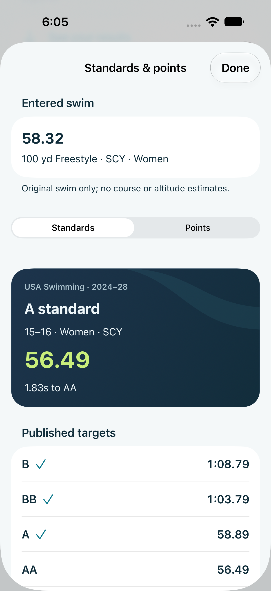
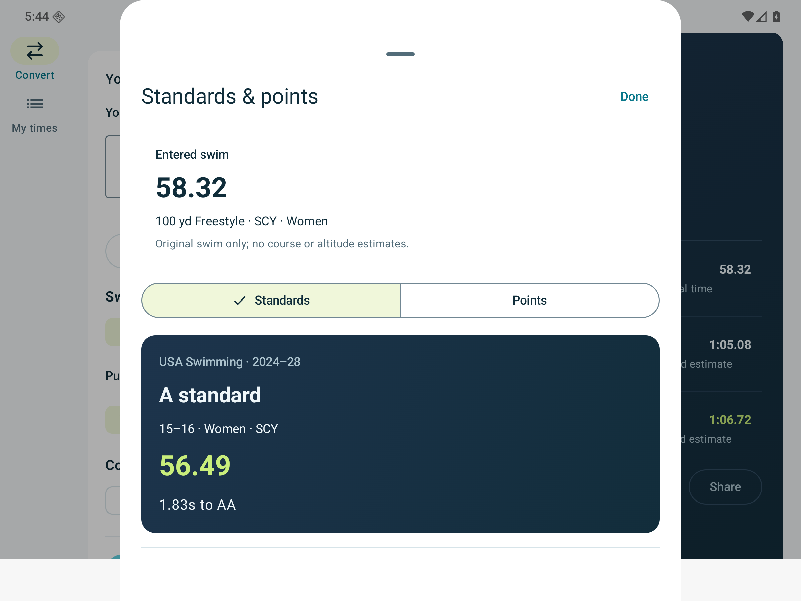
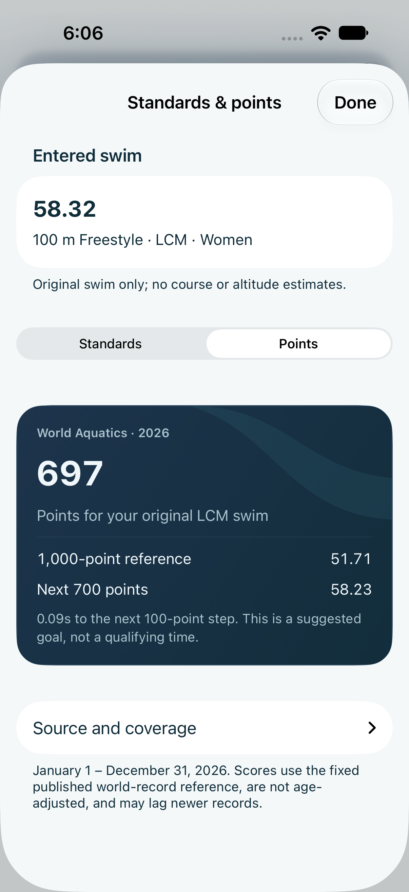
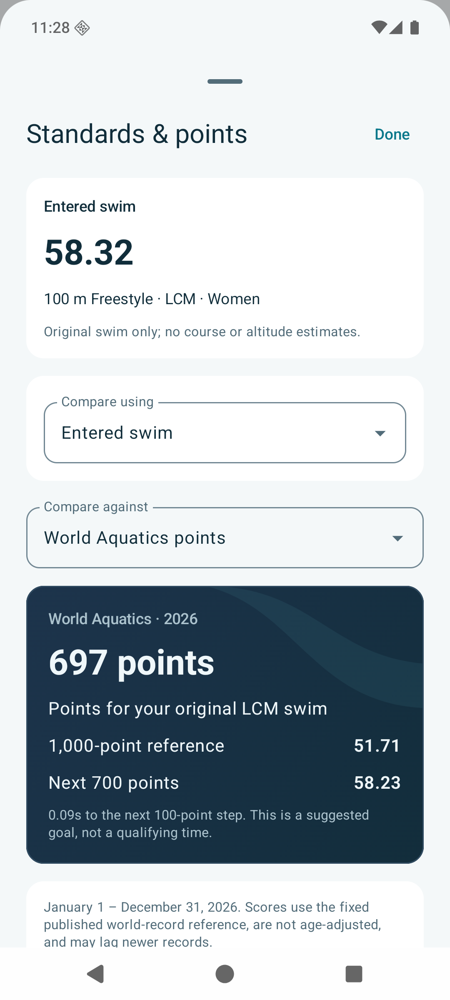
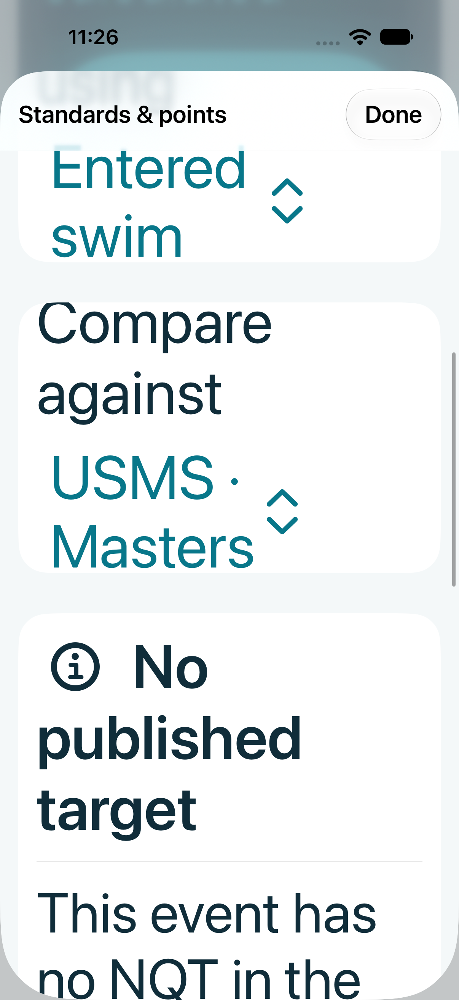
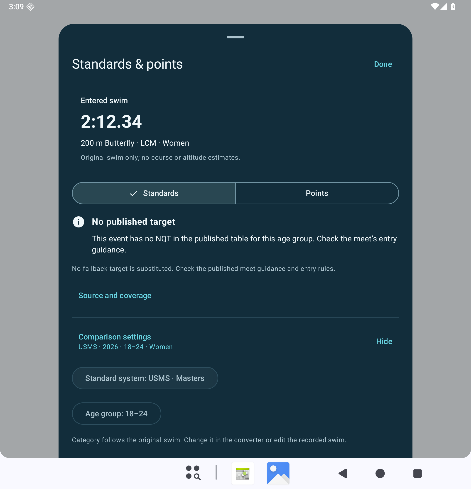
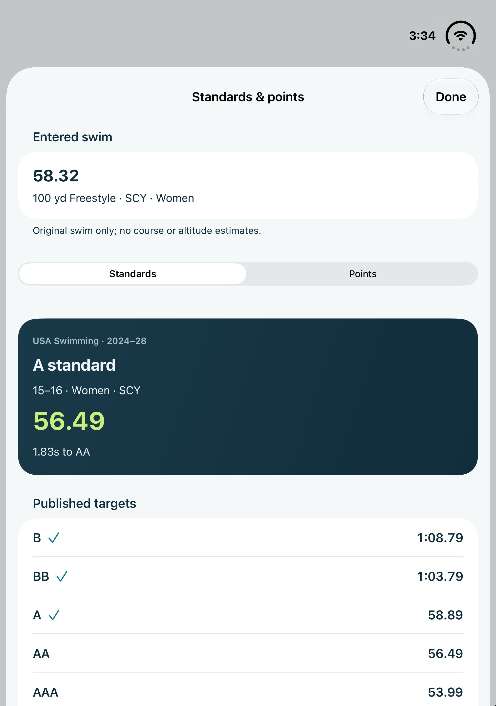
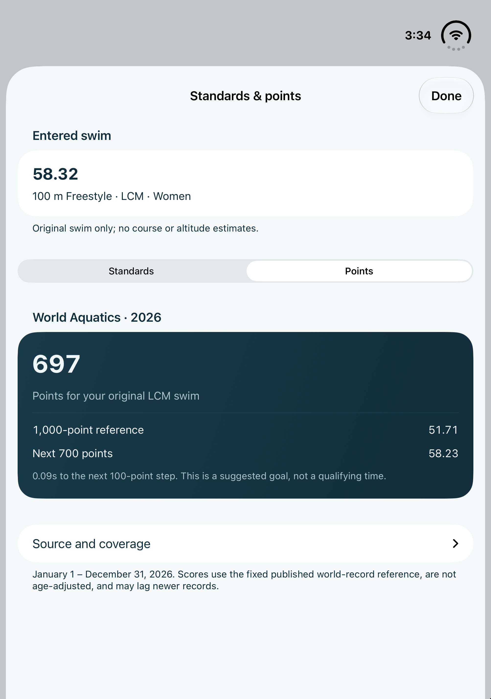

# Native Standards & points review

Captured October 18, 2026 from real simulator/emulator builds. Sample swims only.
The view opens from Convert and from a recorded performance in My times. It
compares the original time/event/course/category, never a converted estimate.

| iOS 27 · compact, light | Android API 36 · expanded, light |
| --- | --- |
|  |  |

Both use generated palettes, a navy gradient and lime next-target time, while
retaining native segmented controls, sheets, lists and pickers. Age/provider
settings start expanded and can subsequently be disclosed. Separate youth and
Masters ages and comparison mode persist locally; category follows the swim.

| iOS · World Aquatics points | Android · World Aquatics points |
| --- | --- |
|  |  |

Missing Masters targets remain missing and SCY swims remain unscored. Sources,
coverage and meet-entry limitations are available without obscuring the result.
The lookups, comparisons and settings work offline; source links need a network.

| iOS · accessibility XXXL | Android · 200% text, dark |
| --- | --- |
|  |  |

## Verification

- Rust tests check every published youth cutoff, exact and 0.01s slower, and
  Masters equality/gaps. The same assessment API is exposed to JS/Swift/Kotlin.
- 6,061 shared cases agree in Node/Wasm, Chromium/Wasm, Swift and Kotlin;
  69 packed SDK contract fixtures and TypeScript consumers pass.
- iOS: 19 tests (6 storage/unit + 13 UI), including original-swim semantics,
  B–AAAA, remembered ages/mode, recorded category, SCY coverage, metric points,
  rotation and largest accessibility text. The screenshot-only capture was
  repeated after moving it before the rotation animation.
- Android: 22 instrumentation tests, plus a fresh 14-case converter run after
  the final card contrast adjustment. Injected book/tabletop changes keep the
  benchmark sheet and original swim. Large-text controls remain reachable.
- Web: 126 unit tests, 33 browser tests with one desktop-inapplicable skip,
  18 production-runtime tests, and Svelte/TypeScript checks pass.
- MCP's existing six tools retain their contracts and SDK-equal results over
  packed offline stdio and local Streamable HTTP in both protocol modes.

These checks establish simulator/emulator behavior. Physical devices,
VoiceOver/TalkBack, actual fold hardware, store review and release signing remain
release checks. The added JavaScript benchmark helper is **unreleased**; the
published SDK 0.1.0 archive is unchanged.

## iPhone Duo and keyboard follow-up

The original-swim/settings/points test also passes on the iPhone Duo with iOS
27.1. These actual inner-display captures use simctl display 3; XCTest's generic
screenshot attachment is black on that simulator. Only local screenshot timing
was paused to capture the display; application code was unchanged.

| Duo · Standards | Duo · Points |
| --- | --- |
|  |  |

The first CI pass exposed a keyboard focus issue in the existing adaptive
converter: raw GeometryReader height changes restarted focus restoration during
keyboard dismissal. The layout key now describes the actual compact/expanded/
divided input hierarchy. Done dismissal and keeping entry focus across rotation
are checked together; the record/benchmark test confirms the actual category,
time and successful transition to My times after the keyboard closes.

A second Duo check verified that the keyboard no longer collapses a wide input
pane. Width/native divisions/text size now choose the arrangement; height stays
scrollable. The extended rotation test also starts a fresh wide entry and checks
Done dismissal in both orientations. The paired recording/rotation checks pass
on iPhone 18 Pro/iOS 27.0 and Duo/iOS 27.1.
