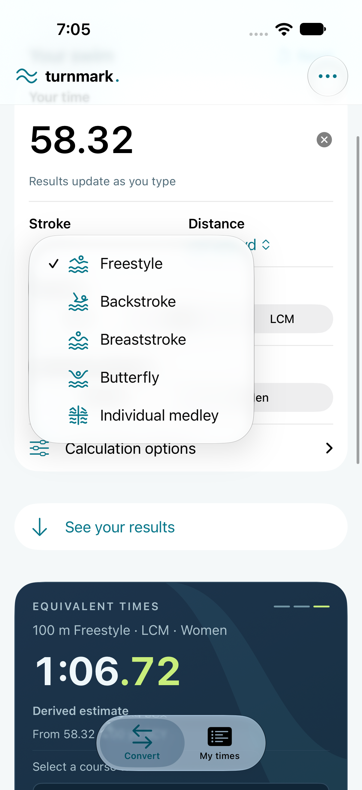
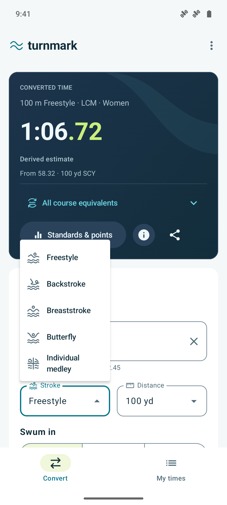
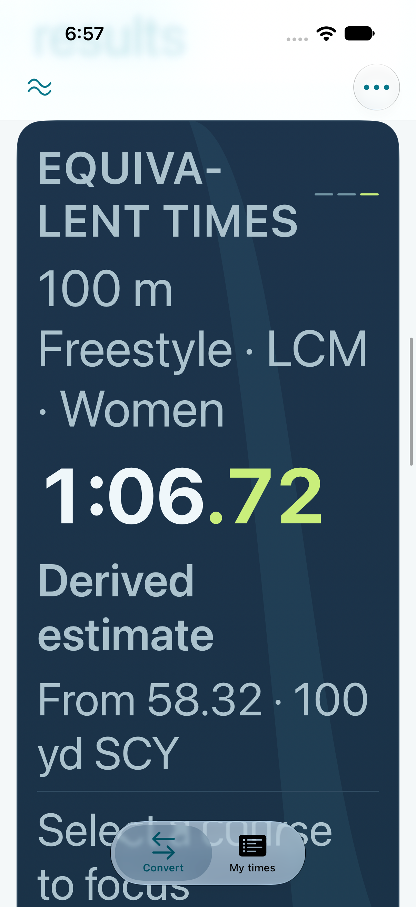

# Native visual review

Updated October 19, 2026. All images below are actual simulator/emulator captures
with sample swims. They are not mockups or store artwork. This review supersedes
the earlier header-free, large-title and mixed-surface presentations. Earlier
research and adaptive baselines remain in [Native Design Review](NATIVE_DESIGN_REVIEW.md)
and [Adaptive Layout](ADAPTIVE_LAYOUT.md).

## Default phone views

Both phone apps put editable inputs before results. Fresh installs start with a
blank time and direct entry; the README captures show this entered sample:
women’s 100 freestyle, 58.32 in SCY. A valid swim reveals **See your results** as
a scroll shortcut, without moving the form while someone types. Stored drafts
still restore on relaunch. Reset clears the clock and results while retaining
selected event/course/category/method choices.

[Fresh iOS arrival](screenshots/ios-converter-arrival-light.png) ·
[Fresh Android arrival](screenshots/android-converter-arrival-light.png)

| iOS 27 · iPhone 18 Pro                                                                                                             | Android API 36 · phone                                                                                                            |
| ---------------------------------------------------------------------------------------------------------------------------------- | --------------------------------------------------------------------------------------------------------------------------------- |
|  |  |

A compact **turnmark.** wordmark and canonical wave share one native toolbar row
with the overflow menu. The period uses the generated accent color. iOS leaves
the wordmark unframed and keeps the system glass overflow control; Android uses
its Material app bar and menu. About and published methodology are reachable
from both. At large text sizes the wordmark can yield to the wave, retaining the
Turnmark accessibility label and space for the menu.

## Surfaces and native controls

Convert, Standards and Points use one numerical surface: an opaque gradient
between generated dark navy roles, a quiet static accent ribbon, readable event
context and restrained lime hundredths/next-target emphasis. Supporting content
follows the current light/dark appearance. No independent component palette or
native dependency upgrade was introduced.

- iOS uses grouped SwiftUI Forms, native menus and segmented pickers, TabView,
  sheets and system glass actions on supported versions. **How this is calculated**
  opens details; Standards & points and native Share remain secondary actions. Increased contrast and
  Reduce Transparency hide the decorative ribbon.
- Android uses Material 3 exposed dropdown fields, single-choice segmented
  choices, grouped supporting cards, sheets and native bottom navigation/rail.
  Stroke and distance share a row when space permits and stack in narrower panes
  or at large text sizes. Very narrow course/category choices use dropdowns.
- The entered swim stays separate from estimates. Destination event distance,
  course and category remain visible; original, published and derived labels
  retain their meaning. Missing targets stay missing and SCY stays unscored in
  World Aquatics points.

[iOS result, dark](screenshots/ios-native-result-dark.png) ·
[iOS result, light](screenshots/ios-native-result-light.png) ·
[Android result, light](screenshots/android-current-result-light.png) ·
[Android result, dark](screenshots/android-current-result-dark.png)

All three course equivalents are visible together for valid inputs. Tapping a
row focuses its full result with the SDK-returned destination context. The
selected row has a checkmark, lime emphasis and an accessible selected state;
there is no second destination-course selector in the input form. Unsupported
course estimates remain unavailable while the original row stays usable.

Calculation details quietly compare NCAA and Colorado for that same destination.
The selected method still drives the main result; NCAA remains the default.
**Method difference** compares two published rules, not statistical uncertainty.
The explanation distinguishes multiplier/offset inputs from the physical effect
of pool length and turns; it makes no claim of personal technique modeling.

[iOS method comparison](screenshots/ios-method-comparison-light.png) ·
[Android method comparison](screenshots/android-method-comparison-light.png)

## Shared glyphs and logging

The [shared vector catalog](../design/ICONS.md) owns the five supported stroke
icons, distance, equivalents and stopwatch-plus. iOS uses vector template PDFs;
Android uses VectorDrawables. Web, widget and MCP inline the same paths with
semantic tint. The toolbar wave derives from the existing brand geometry.
Readable labels and accessible values remain available.

| iOS stroke menu                                                                                                      | Android stroke menu                                                                                                |
| -------------------------------------------------------------------------------------------------------------------- | ------------------------------------------------------------------------------------------------------------------ |
|  |  |

**Log swim** uses the stopwatch-plus and opens a confirmation form for an actual
performance. It sits after the equivalents with the helper “Add your entered
swim to My times.” The confirmation form supports a date and optional meet. It never records a converted estimate as a personal best. My times
retains Recent and Best times, editing, removal and portable export/import.
Web’s **Save comparison** bookmarks its conversion setup and remains separate.
See [history and backup limits](MEET_HISTORY.md).

## Standards and Points

| iOS · youth standards                                                                                                  | Android · youth standards                                                                                                        |
| ---------------------------------------------------------------------------------------------------------------------- | -------------------------------------------------------------------------------------------------------------------------------- |
|  |  |

| iOS · World Aquatics points                                                                                    | Android · World Aquatics points                                                                                             |
| -------------------------------------------------------------------------------------------------------------- | --------------------------------------------------------------------------------------------------------------------------- |
|  |  |

Benchmarks use the original time/event/course/category, never a course or altitude
estimate. Separate youth/Masters ages and comparison mode persist locally. Source
editions and meet-entry limits remain visible. The converter has one Standards &
points entry point; it does not repeat the sheet’s next-standard assessment in
another nearby card. More coverage and validation notes
are in [the standards review](NATIVE_STANDARDS_REVIEW.md). The selector also
includes the editioned [Futures, Junior Nationals and NISCA benchmarks](NATIONAL_BENCHMARKS.md).

## Text scaling and adaptive layouts

| iOS · largest accessibility text                                                                                                                          | Android · 200% text, dark                                                                                                                       |
| --------------------------------------------------------------------------------------------------------------------------------------------------------- | ----------------------------------------------------------------------------------------------------------------------------------------------- |
|  |  |

The complete result clock stays within its region. Context and labeled actions
wrap, and longer content scrolls; these captures do not claim every control fits
in one viewport. iOS regression assertions cover ordinary-size action height,
wordmark width/toolbar alignment, and largest-text clock/action bounds. Form row
virtualization is handled by the test scroll helper.

Expanded conversion keeps inputs and results in independently scrollable panes.
Tabletop places a concise result above the division and inputs below it. Drafts,
active entry and the original swim behind a benchmark sheet survive layout
changes. My times uses native single-column or list/detail navigation as space
permits.

[Earlier Duo geometry baseline](screenshots/ios-current-duo-open.png) ·
[Earlier Android book geometry baseline](screenshots/android-current-book.png) ·
[Earlier Android tabletop geometry baseline](screenshots/android-current-tabletop.png)

These earlier captures document adaptive geometry, not the current phone styling.
Android’s fold pictures use injected WindowManager geometry on an emulator,
not physical fold hardware. The Duo image uses its actual inner display;
XCTest’s generic screenshot attachment is black on that simulator.

## Current verification

The regression suites cover 25 iOS cases (7 storage/unit and 18 UI) and 28
Android instrumentation cases: direct entry/reset, method comparison, altitude
policy and unit changes, the Colorado distance caveat, original-swim benchmarks,
logging, text scaling and adaptive geometry. Current run status is recorded in
[the required checks](https://github.com/Stanback/turnmark/actions/workflows/shared-engine.yml).

The complete passing local iOS UI baseline took 525 seconds, with a 22-second
rotation/focus case. Focused checks cover subsequent harness corrections and
visible restoration of enabled altitude settings. These are local measurements,
not simulator timing guarantees. Physical-device and assistive-technology review
remain release checks.

## Altitude parity follow-up

The optional **Calculation options** disclosure groups **Course conversion**
with an altitude toggle, feet/meters and a separate
USA Swimming / NCAA altitude policy on both apps. Restored enabled settings
start expanded so their effect remains visible. Settings keep a compact
selected-policy preview; calculation details show both deductions
and sea-level estimates; course conversion follows the selected deduction in
Rust. Standards, points and logged performances retain the original swim.
See [the common contract](ALTITUDE.md) for source editions and boundaries.

[iOS Calculation options](screenshots/ios-calculation-options.png) ·
[Android Calculation options](screenshots/android-calculation-options.png) ·
[iOS altitude policies](screenshots/ios-altitude-policies.png) ·
[Android altitude policies](screenshots/android-altitude-policies.png)

UI automation disables app animations only in DEBUG when the harness sets
`TURNMARK_UI_TESTS=1`; production animation behavior is unchanged. Scroll searches
use the stable app viewport rather than a dismissed sheet's stale navigation/tab
accessibility frames. Targets still need to be hittable within content bounds.
Time-entry setup uses the real Clear time action and checks the replacement,
without assuming a center tap leaves the caret after existing digits. Rotation
still types into the current responder without tapping or refocusing it.
Per-test execution is bounded so simulator idle waits cannot consume a whole job.

The documented Colorado SCM/SCY distance-freestyle rule carries an explicit
caveat beside the result and in method details. The 4:11.36 SCM 400 free
regression retains the documented 3:46.45 result with its correct 500 yd event
context; NCAA gives 4:47.30. This is a known limitation of the documented Colorado
rule, not a change to its coefficients.

[iOS distance caveat](screenshots/ios-distance-caveat.png) ·
[Android distance caveat](screenshots/android-distance-caveat.png)

Physical-device ergonomics, VoiceOver/TalkBack, real fold transitions and store
signing/review remain release checks. No cloud sync or npm publication is part
of this pass.
