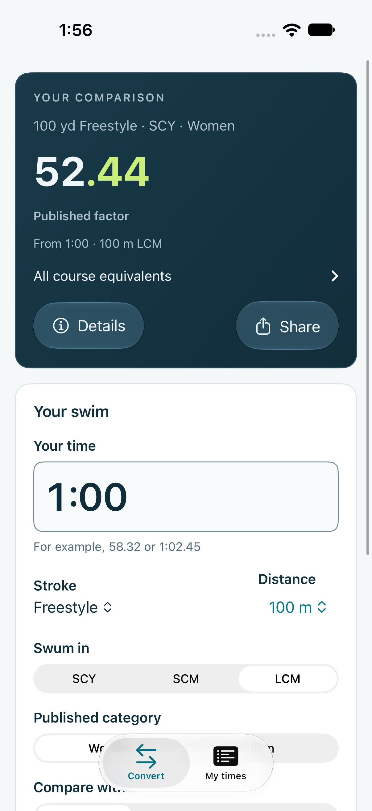
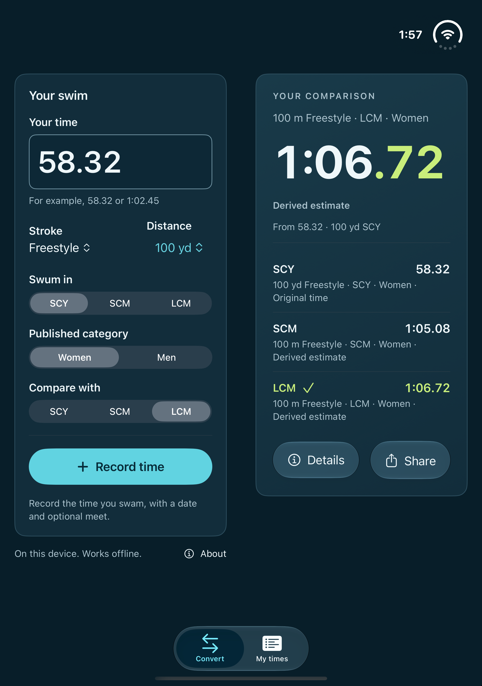
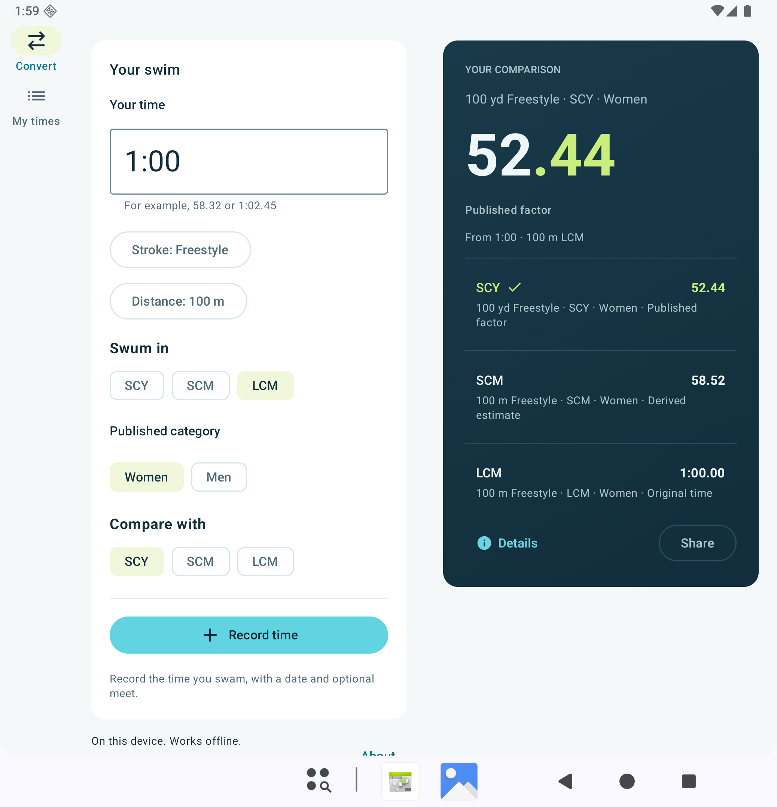

# Native visual review

October 18, 2026. These are actual simulator/emulator app captures, not mockups
or App Store artwork. The earlier images in NATIVE_DESIGN_REVIEW and the Duo
baseline remain historical references. Physical-device ergonomics, VoiceOver
and TalkBack are still release checks. Subsequent Standards & points work and
its current verification are recorded in [the standards review](NATIVE_STANDARDS_REVIEW.md).

## What changed

- Generated CSS, Swift and Kotlin share one palette/spacing/radius source. Native
  system typography, controls, navigation and materials retain platform behavior.
- The result has a signature opaque navy surface in both appearances, a tabular
  clock with restrained lime hundredths, visible destination/category context
  and original/published/derived labels. Details and sharing remain contextual.
- Convert and My times match the two main jobs. Record time confirms an actual
  swim; Recent / Best times filters actual records. An older comparison bookmark
  remains separate and explicitly restorable/removable.
- Expanded conversion shows inputs beside the result. Tabletop uses a concise
  result above the fold and independently scrollable inputs below. My times
  offers list/detail when there is sufficient room and native single-column
  navigation when it is narrower.

## Typography and spacing review

Review covers ordinary iPhone text and the largest accessibility category,
Android phone/foldable layouts, narrow Android at 360 × 640 dp with 200% text,
both appearances, recorded swims and keyboard entry. Check full clocks, context
wrapping, action labels, card padding, picker alignment and scrolling to actions.

Corrections from reviewing the rendered screens:

- Record time uses the cyan action fill with a contrasting, stronger label and
  a plain plus icon. Link teal is not used as its fill on iOS.
- IM is the compact selected stroke label; selection menus, full event context
  and accessible values retain Individual medley. No forced single-line clipping
  is applied to long descriptions or meet names.
- The time hint uses concrete examples rather than a long compound format word
  that split awkwardly at accessibility text sizes.
- My times guidance is a quiet footer on the canvas with shared muted text,
  without a separate charcoal card or row divider. Empty, error and previous-
  comparison rows use the shared navy surface in dark appearance.
- Android stroke/distance controls keep their natural width and flow when the
  pane is narrow; filters/file actions also flow. Large text uses a native
  two-row Material app bar for record/edit/detail titles instead of squeezing
  the title between Cancel and Add swim. The save notice is short.
- Duo converter focus is restored when an active time field moves between panes.
  Manual simulator entry continued through open → book → tabletop using the
  hardware keyboard; a rotation regression also checks typing without retapping.
- Details/Share can reflow; the complete clock fits its region. Body text retains
  normal platform scaling and content remains scrollable.
- Duo's intermediate-width swim list originally stayed over detail actions.
  The narrower workspace now uses a NavigationStack, while wider windows use
  NavigationSplitView, with selected-record state above both layouts. Editors and deletion confirmation
  also live above the changing panes so keyboard/fold reflow cannot discard them.

## Default phone screens

The README uses fresh-install converter captures from main's native Standards &
points build, with the generated navy palette. Both show the default 58.32 SCY
100 freestyle swim for women and its 1:06.72 LCM comparison, in light appearance
with ordinary text size. Only system status indicators are normalized for the
screenshots. Existing simulator/emulator records were not reset. Feature sheets
and expanded layouts remain in the detailed reviews.

[iOS home](screenshots/ios-home-light.png) · [Android home](screenshots/android-home-light.png)

## Captures

| Case                                            | Evidence                                                                                                                                                                                                                                                |
| ----------------------------------------------- | ------------------------------------------------------------------------------------------------------------------------------------------------------------------------------------------------------------------------------------------------------- |
| iPhone result, light / dark                     | [Light](screenshots/ios-native-result-light.png) · [Dark](screenshots/ios-native-result-dark.png)                                                                                                                                                       |
| iPhone Record time action                       | [Light](screenshots/ios-native-record-light.png)                                                                                                                                                                                                        |
| iPhone My times / bests                         | [My times, dark](screenshots/ios-native-times-dark.png) · [Bests, light](screenshots/ios-native-best-light.png)                                                                                                                                         |
| iPhone largest accessibility text               | [Input and reflow](screenshots/ios-native-large-text.png) · [Long clock](screenshots/ios-native-long-clock.png)                                                                                                                                         |
| Duo expanded and book fold                      | [Open](screenshots/ios-native-duo-open-light.png) · [Book](screenshots/ios-native-duo-book-light.png)                                                                                                                                                   |
| Duo tabletop and compact outer display          | [Tabletop, light](screenshots/ios-native-duo-tabletop-light.png) · [Tabletop, dark](screenshots/ios-native-duo-tabletop-dark.png) · [Outer](screenshots/ios-native-duo-outer-light.png) · [My times surfaces](screenshots/ios-native-duo-help-dark.png) |
| Android expanded converter, light / dark        | [Light](screenshots/android-native-book-light.png) · [Dark](screenshots/android-native-result-dark.png)                                                                                                                                                 |
| Android recorded swim and bests                 | [List/detail](screenshots/android-native-times-detail-dark.png) · [Bests](screenshots/android-native-best-dark.png) · [Muted help footer](screenshots/android-native-help-light.png)                                                                    |
| Android injected book / tabletop fold           | [Book](screenshots/android-native-book-test-dark.png) · [Tabletop](screenshots/android-native-tabletop-test-dark.png)                                                                                                                                   |
| Android narrow phone, 200% text, long meet name | [Editor](screenshots/android-long-editor-large.png) · [Meet](screenshots/android-long-meet-large.png) · [Detail](screenshots/android-long-detail-large.png) · [Input](screenshots/android-long-input-large.png)                                         |

The Android fold-test pictures use injected WindowManager geometry on a Pixel
10 Pro Fold emulator profile. They verify the pane arrangement and hinge bounds;
they are not photos of a physical device. Scrolled captures intentionally show
part of a longer form; they do not claim all content fits at once.

## Checks and limits

- 119 JavaScript/design unit checks and 50 CI selection cases passed. Generated
  native palettes are checked before both native app suites.
- iPhone 18 Pro/iOS 27.0 and Duo/iOS 27.1 passed all 16 model/UI cases, including
  the rotation/focus regression. They exercise persistence,
  direct recording, best filtering, source details, invalid/unavailable states,
  original-value sharing, editing and legacy bookmark separation.
- Android API 36 checks the same jobs plus portable import/export. The fold test
  verifies hinge avoidance and preserves input plus focus through book/tabletop.
  A long-event/long-meet test is also exercised at 200% font size.
- No numerical engine, source snapshot, signing or deployment changes. No native
  benchmark/points parity, store submission or translation release is implied.
- Half-window multitasking, physical folding transitions and assistive-technology
  reading/focus remain explicit release work. Standards/points were subsequently implemented; see [their review](NATIVE_STANDARDS_REVIEW.md). Localization remains a follow-up in [native product notes](NATIVE_PRODUCT_NOTES.md).

## Result gradient follow-up

The result surface now uses a quiet, static diagonal gradient from the generated
dark `surfaceRaised` to dark `surface` on both platforms, in both appearances.
All stops remain opaque. White times, muted context, lime highlights and native
button treatments are unchanged. No animation or new color values are added.
Reviewed ordinary iPhone light/dark captures, the open Duo dark preview and
Android's expanded light layout. All 16 iOS and 17 Android tests pass.

| iPhone light                                                  | Duo dark                                                      | Android light                                                      |
| ------------------------------------------------------------- | ------------------------------------------------------------- | ------------------------------------------------------------------ |
|  |  |  |
