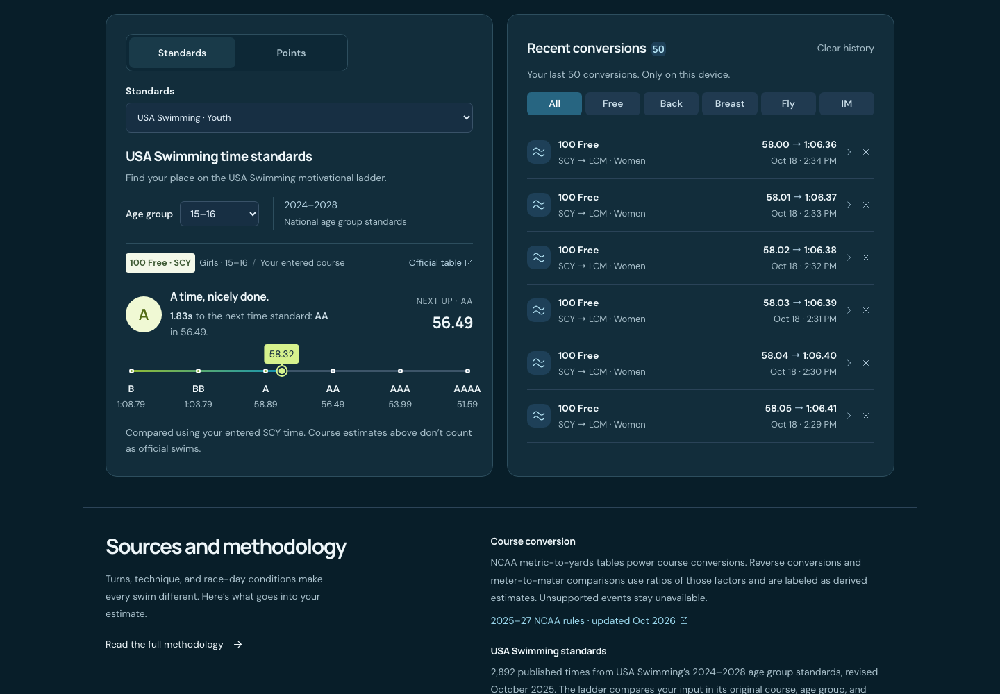
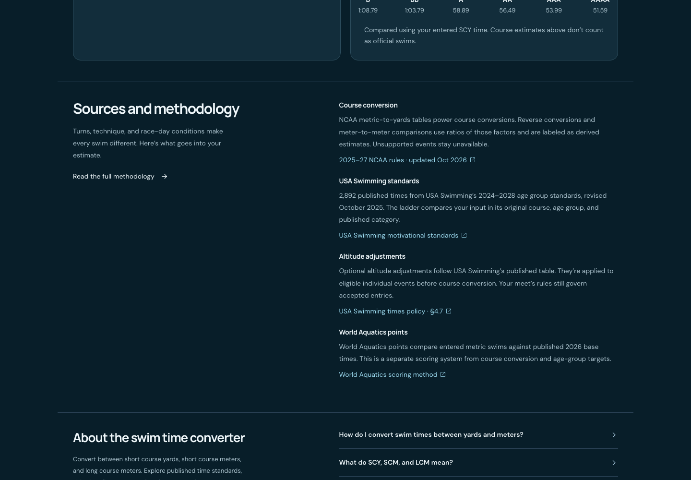
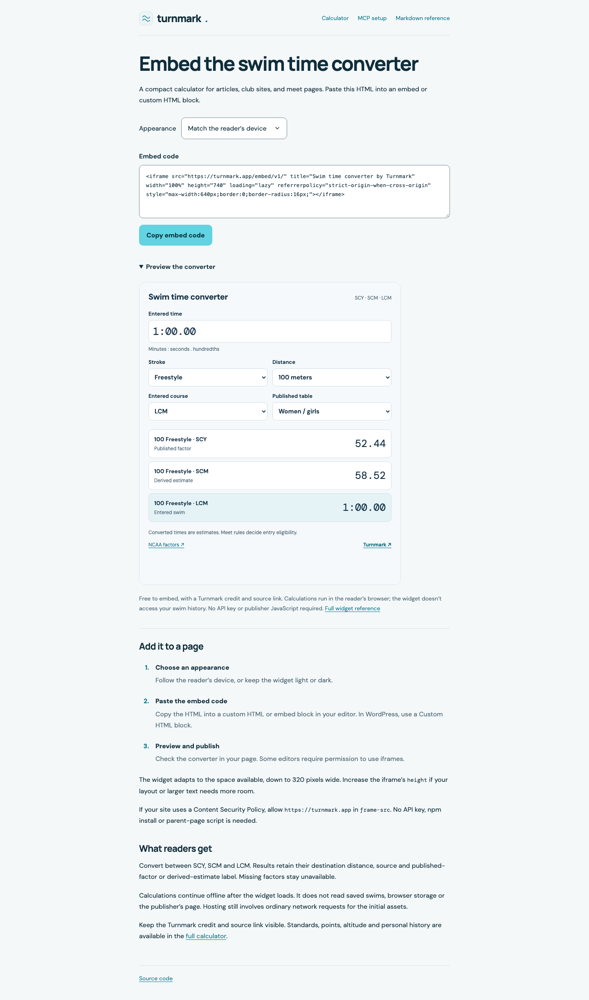
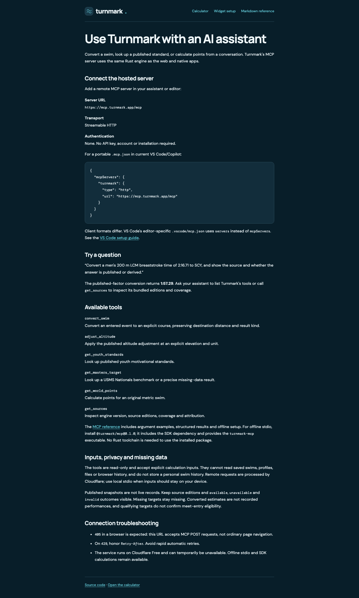
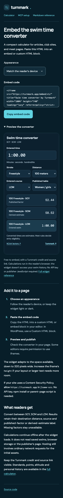
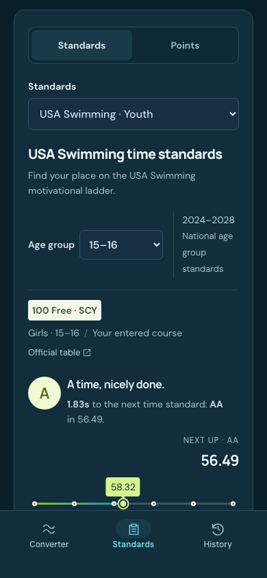
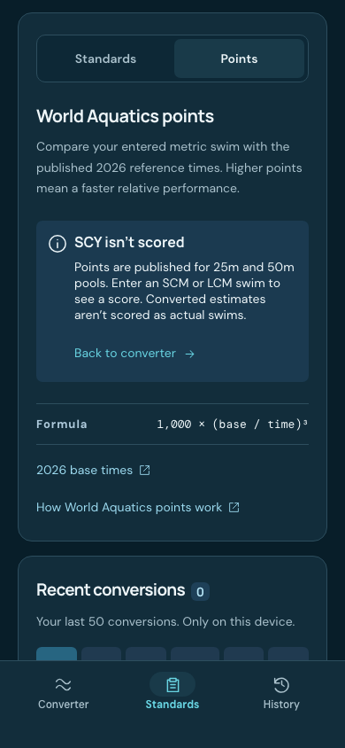
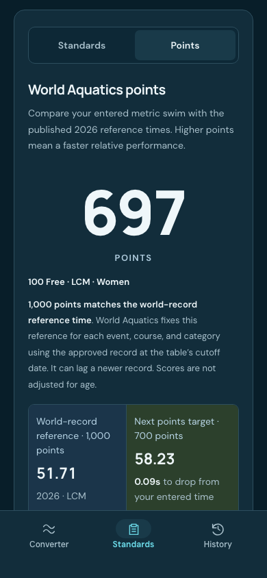

# Web cleanup review

Historical review of the cleanup preceding the converter hierarchy follow-up.
The captures below document that earlier pass. Current layout and screenshots
are maintained in [Converter layout review](CONVERTER_LAYOUT_EXPLORATION.md).
The equal-height standards/history arrangement below has been superseded.

- Recent conversions fills the desktop standards row. Its entries scroll within
  the card; the last entry remains reachable by keyboard. Youth, masters and
  points views are checked. At 900 pixels and below, history uses page scrolling.
- Standards comes before History in navigation and page order. The short
  Standards/Points switch uses equal 44-pixel buttons. Unscored yards swims show
  an explanation and converter action instead of a large dash.
- The mobile web bar paints to the viewport bottom, with its controls above the
  home-indicator inset. The regression check supplies a 34-pixel inset; Safari
  browser chrome remains system-owned. Local iPhone WebKit checks cover both
  points states. A physical installed-PWA check remains a release check.
- Sources/methodology and FAQ share a desktop column boundary and aligned starts.
- Widget and MCP setup use one stylesheet, generated Turnmark palette and fonts,
  760-pixel content width, responsive brand header and keyboard focus treatment.
  Both remain readable without JavaScript. MCP is still static HTML; processing
  its CSS with Vite does not add a client application or change the MCP service.
- Widget setup has an inset dropdown chevron and a spaced three-step list.

Validation: 119 unit tests; 51 CI-selection tests; 33 browser tests (one existing
mobile-only skip); 18 production tests, including no-script rendering, offline
navigation and light/dark accessibility audits. Svelte/TypeScript checks pass
without warnings. The paired native result-gradient follow-up has its own
[visual review](NATIVE_VISUAL_REVIEW.md#result-gradient-follow-up) and passes all
16 iOS and 17 Android tests. The numerical engine is unchanged.

| Widget setup, light                                             | MCP setup, dark                                          |
| --------------------------------------------------------------- | -------------------------------------------------------- |
|  |  |

| Mobile standards                                        | Unscored SCY                                                           | Metric points                                               |
| ------------------------------------------------------- | ---------------------------------------------------------------------- | ----------------------------------------------------------- |
|  |  |  |
