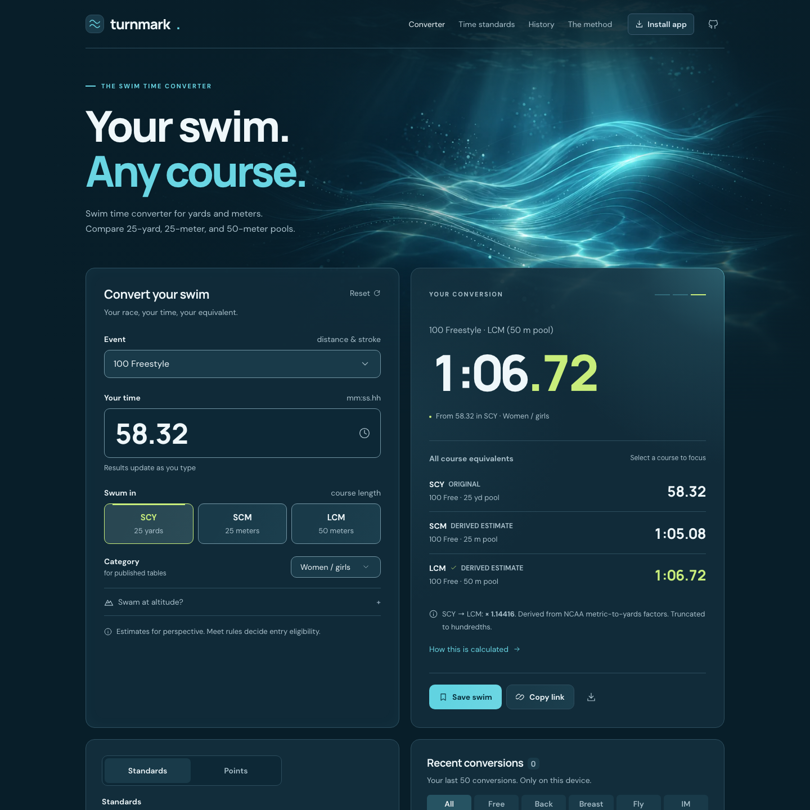
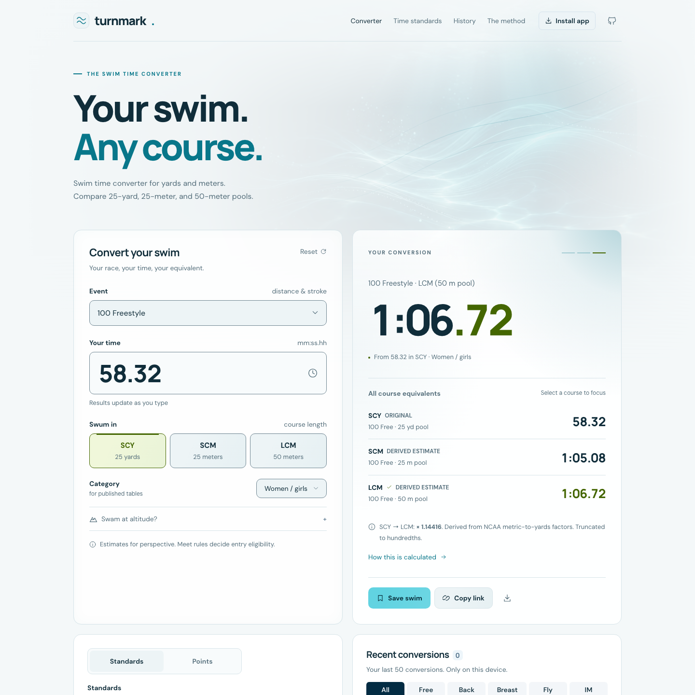

# Water, light and interaction

The converter header combines a static water-light background with three faint
open SVG currents. The user-supplied `Luminous Underwater Wave Ribbons.png`
(1672 × 941) is encoded as `public/images/water-ribbons.webp` with cwebp quality 88,
method 6 and metadata removed: 80,280 bytes. The original PNG is untouched.
Artwork is centered and capped at its natural 1672-pixel width, with a fading
outer edge instead of scaling up on wide screens. The darker blend behind
navigation and copy preserves readability; light mode
uses a much fainter treatment. The background is included in the offline build.

The open currents fade in over 2.8 seconds, then stay still; reduced motion shows
them immediately. Water and currents are hidden at 680 pixels and below, matching the converter’s single-column breakpoint, to keep
the mobile form close to the heading. No animation library, pointer tracker,
shader, new dependency or calculation change is involved.

The input card has a very subtle symmetric inner-edge glow. Both cards are
slightly translucent; the result retains the stronger upper-corner radial light.
Input fields keep solid readable surfaces; Install app has a slightly translucent fill. The conversion card keeps a static,
slightly brighter default glow with no container hover/focus effect. Fine-pointer
hover and keyboard focus on action/course buttons add a faint sheen and glow;
reduced motion disables those transitions. Course rows have a wider rounded
hit/hover area while labels, times and dividers keep their alignment.

Three decorative marks mirror the selected SCY, SCM or LCM result. The top source
chip is removed; the calculation explanation and official NCAA source remain in
the methodology. Reset has a glyph, the privacy note lives in the footer, and
its wordmark uses the same type weight and colored dot as the header. The theme
controls have a named Appearance landmark. The result has a static cyan rim
that fades out along the top and right edges from its upper-right corner.
Inactive Standards/Points buttons have a restrained hover/focus tint. History
filters, icons, standards pickers and benchmark help now use the same generated
surface/input/border roles as the converter instead of independent older blues. Native
select pickers retain keyboard and mobile behavior, with custom chevrons inset
20 pixels. The footer separates brand/credit from documentation and privacy/source
notes into two rows, with stacked groups on phones. Clear history has a trash
glyph and a browser confirmation; Cancel preserves stored conversions.

Validation: Svelte/TypeScript; unit, browser and production suites; direct
Chromium and WebKit checks in light/dark with no Axe violations, stable hover
bounds, all three indicator states, 320–3440-pixel layouts without horizontal
overflow, reduced motion and finite animation. Screenshots use actual calculated
values, not illustrative conversion ratios. This web-only change needs no native
rebuild.

